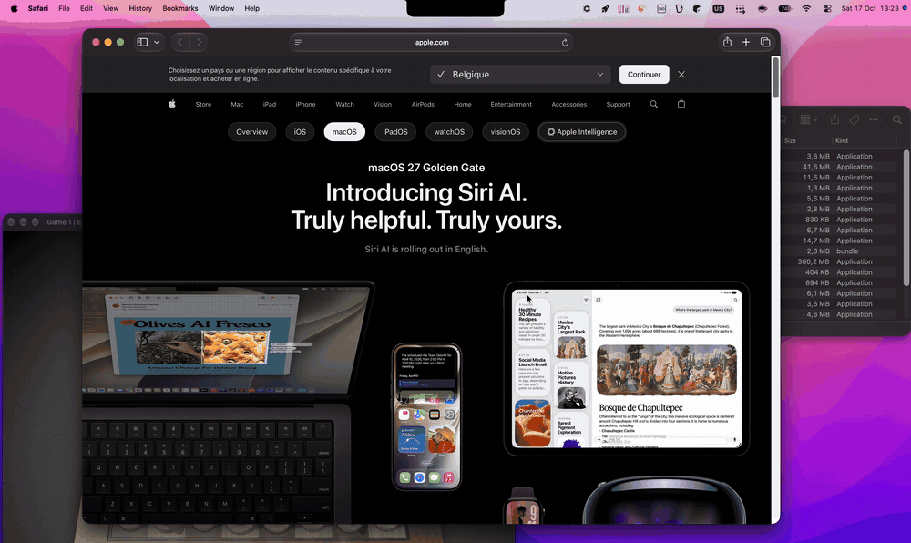

<p align="center">
  
</p>

<h1 align="center">MissionStrike</h1>

<p align="center">
  <strong>Close windows straight from Mission Control.</strong><br>
  Middle-click a thumbnail and it's gone, like closing a browser tab.
</p>

<p align="center">
  
</p>

Mission Control shows every window you have open, but it only lets you look at them. To clean up you have to pick each window, wait for it to come forward and hit ⌘W, then do it all again. MissionStrike lets you close, minimize or quit right from the overview.

- **Middle-click or ⌥-click** a window to close it. Do the same on a Space at the top to close the Space.
- **Add ⇧** to minimize instead, or **⌘** to close all of that app's windows.
- **⌘W, ⌘M, ⌘H, ⌘Q** work on the window under the pointer.
- **Right-click** a window for Close Others, Hide Others and more. Right-click the background to clear the whole Space, or quit apps that have no windows left.
- **Press F** to put a letter on every window, then type the letter and an action. You never touch the mouse.

Hold ⌥ to see which window a click will hit, and how many windows each app has here. Keep holding for a cheat sheet. If an app asks to save before closing, MissionStrike shows that on the window instead of failing without a word.

## Install

```bash
brew install --cask schoofsebert/tap/missionstrike
```

Open it once and follow the setup to grant Accessibility access. MissionStrike runs from the menu bar and keeps itself up to date.

Needs a Mac with Apple silicon and macOS 14 Sonoma or later. Keyboard hints and window counts need macOS 27.

<details>
<summary>Other ways to install</summary>

**Install script.** It downloads the latest release, checks its signature and installs it to `/Applications`. No `sudo` needed.

```bash
curl -fsSLO https://github.com/SchoofsEbert/MissionStrike/releases/latest/download/install.sh
bash install.sh
```

**Manual.** Download `MissionStrike.app.zip` from [Releases](https://github.com/SchoofsEbert/MissionStrike/releases), move the app to `Applications`, and clear the quarantine flag:

```bash
xattr -cr /Applications/MissionStrike.app
```

Releases are signed with MissionStrike's own certificate, not a paid Apple Developer ID. That's why the quarantine flag has to go; Homebrew and the script clear it for you.

</details>

<details>
<summary>Updating</summary>

MissionStrike checks for updates once a day, or whenever you ask from the menu bar. **Install & Relaunch** downloads the update, verifies its signature and restarts the app. If anything fails, your current version stays. Homebrew leaves updates to the app, so `brew upgrade` only touches MissionStrike with `--greedy`.

</details>

Every gesture can be switched off in Settings, where you can also change the modifier key, middle-click Dock icons to quit apps, or add a poof when a window closes.

## Building from source

```bash
git clone https://github.com/SchoofsEbert/MissionStrike.git
cd MissionStrike
scripts/package-app.sh
```

Needs Xcode or the Swift command line tools on an Apple-silicon Mac. The app ends up in `MissionStrike/dist/`. Without the signing certificate the build is signed ad hoc, so macOS asks for Accessibility again after every build. Maintainers: see [RELEASING.md](RELEASING.md).

<details>
<summary>How it works</summary>

1. A global event tap listens for clicks, ⌘ shortcuts and modifier keys. Everything outside Mission Control passes straight through.
2. Mission Control is detected by the Dock and WindowManager overlay windows.
3. The click is hit-tested through Accessibility:
   - **Spaces Bar** → `AXRemoveDesktop` on the Space under the cursor.
   - **Window thumbnail (macOS 27+)** → the thumbnail's `wid` → the real window → close, minimize or close all. Thumbnails of windows on other Spaces are skipped.
   - **Older Mission Control** → the classic `AXWindow` close button.
4. On macOS 27+, click coordinates are flipped vertically to match Accessibility's top-left origin.
5. Window counts and keyboard hints list the thumbnails from WindowManager's Accessibility tree off the main thread, and draw on click-through panels that Accessibility hit-testing looks through.

If something doesn't work, **About → Copy Diagnostics** copies what MissionStrike saw (never window titles) for a bug report.

</details>

## About this project

🤖 This entire application (including this README) was "vibe-coded". It started as an experiment in AI-driven development and a fix for a personal workflow frustration, without the author writing or knowing any Swift.
