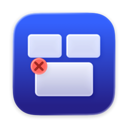

<p align="center">
  
</p>

<h1 align="center">MissionStrike</h1>

<p align="center">
  <strong>Close, minimize and manage windows straight from Mission Control.</strong>
</p>

---

> 🤖 **Note:** This entire application (including this README) was completely "vibe-coded". It was built as an experiment to test AI-driven development and solve a personal workflow frustration—without the author needing to write or know any Swift!

## Features

In Mission Control, point at a window or Space and:

| Action | Does |
|---|---|
| **Middle-click** or **⌥ Option + click** | Close the window or Space |
| **⇧ Shift + click** | Minimize the window |
| **⌘ Command + click** | Close all of that app's windows |
| **⌘W / ⌘M / ⌘H / ⌘Q** | Close, minimize, hide or quit |
| **Right-click** | A menu with all of the above, plus Close Others and Hide Others. Right-click the background to quit apps with no windows. |

Hold your modifier key and a small badge shows which window a click will hit. If an app asks to confirm a close, such as to save changes, an orange badge on the window says so, and Mission Control stays open. A trackpad tap confirms each close or minimize, and a grey badge shakes when one doesn't go through. Optionally, middle-click a Dock icon to quit the app, or add a poof when closing. You can switch each feature on or off and change the modifier key in Settings.

## Installation

MissionStrike needs a Mac with Apple silicon and macOS 14 Sonoma or later. There's no Intel build.

### Homebrew (recommended)

```bash
brew install --cask schoofsebert/tap/missionstrike
```

### Install script

```bash
curl -fsSLO https://github.com/SchoofsEbert/MissionStrike/releases/latest/download/install.sh
bash install.sh
```

The script comes from the latest release rather than the main branch. It downloads the app, checks its signature, and installs it to `/Applications`, keeping your current copy until the new one is in place. It needs no `sudo`; run it from an account that can write to `/Applications`.

### Manual

Download `MissionStrike.app.zip` from [Releases](https://github.com/SchoofsEbert/MissionStrike/releases), move the app to `Applications`, and clear the quarantine flag macOS puts on unsigned downloads:

```bash
xattr -cr /Applications/MissionStrike.app
```

> ℹ️ Releases are signed with MissionStrike's own certificate rather than a paid Apple Developer ID. That's why Homebrew and the script remove the quarantine flag for you.

### Accessibility permission

MissionStrike needs Accessibility access to see clicks in Mission Control and close windows. The setup guide on first launch walks you through it. Updates keep the permission.

## Updating

MissionStrike checks for updates once a day; you can also check from the menu bar. A window shows what's new, and **Install & Relaunch** downloads the update, verifies its signature and restarts the app. If anything fails, the current version stays in place. **Skip This Version** stops the daily check from offering that version; checking from the menu bar still shows it.

Homebrew leaves updates to the app, so `brew upgrade` only updates MissionStrike with `--greedy`.

## Building from Source

Requires an Apple-silicon Mac with Xcode or the Swift command line tools.

```bash
git clone https://github.com/SchoofsEbert/MissionStrike.git
cd MissionStrike
scripts/package-app.sh
```

The signed app and zip end up in `MissionStrike/dist/`. Without the MissionStrike signing certificate the build is signed ad hoc, so macOS asks for Accessibility again after every build.

### Release signing

Releases are signed with a self-signed certificate; the in-app updater and `install.sh` reject downloads that aren't. Each release also has a [build provenance attestation](https://docs.github.com/en/actions/security-for-github-actions/using-artifact-attestations): `gh attestation verify MissionStrike.app.zip --repo SchoofsEbert/MissionStrike`.

Pushing a `v*` tag runs the release workflow. It builds and tests the tag without any secrets, then waits for approval before the `release` environment signs the build. Only that signing step sees the certificate, and only for a tag on `main`. The workflow can be re-run for the same tag; it updates the existing release and cask.

For maintainers, the certificate's safety depends on these repository settings:

- **Environment `release`**: required reviewers, deployment limited to `v*` tags, and the `MISSIONSTRIKE_P12_BASE64` and `MISSIONSTRIKE_P12_PASSWORD` secrets stored there rather than as repository secrets.
- **Environment `homebrew-tap`**: deployment limited to `v*` tags, with the `HOMEBREW_TAP_DEPLOY_KEY` secret.
- **Tag ruleset** for `v*`: only maintainers may create tags, and nobody may update or delete them.

Keep an offline copy of the P12 and its password. If the certificate expires, is lost, or may have leaked:

1. If it may have leaked, delete the environment secrets at once so the workflow can't sign with it.
2. Create a new self-signed code signing certificate named "MissionStrike Code Signing", and store its P12 in the `release` environment.
3. Replace the certificate hash in `CodeSigning.swift` and `install.sh`, and release a new version.
4. Tell users to reinstall with Homebrew or the install script. The updater in their copy only accepts the old certificate, so it won't install the new release, and macOS asks for Accessibility again because the signature changed. If the old key leaked, say so, since anyone holding it can sign an update that older copies accept.

## How it Works

1. A global event tap listens for clicks, ⌘ shortcuts and modifier keys. Everything outside Mission Control passes straight through.
2. Mission Control is detected by the Dock and WindowManager overlay windows.
3. The click is hit-tested through Accessibility:
   - **Spaces Bar** → `AXRemoveDesktop` on the Space under the cursor.
   - **Window thumbnail (macOS 27+)** → the thumbnail's `wid` → the real window → close, minimize or close all.
   - **Older Mission Control** → the classic `AXWindow` close button.
4. On macOS 27+, click coordinates are flipped vertically to match Accessibility's top-left origin.

If something doesn't work, **About → Copy Diagnostics** copies what MissionStrike saw (never window titles) for a bug report.
