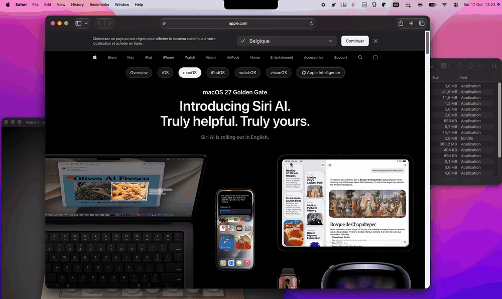

<p align="center">
  
</p>

<h1 align="center">Vantage</h1>

<p align="center">
  <strong>Every window, within reach.</strong><br>
  Close windows straight from Mission Control and snap them side by side from the keyboard.
</p>

<p align="center">
  
</p>

Mission Control shows every window you have open, but it only lets you look at them. To clean up you have to pick each window, wait for it to come forward and hit ⌘W, then do it all again. Vantage lets you close, minimize or quit right from the overview, and put windows side by side from the keyboard.

## In Mission Control

- **Middle-click or ⌥-click** a window to close it. Do the same on a Space at the top to close the Space.
- **Add ⇧** to minimize instead, or **⌘** to close all of that app's windows.
- **⌘W, ⌘M, ⌘H, ⌘Q** work on the window under the pointer.
- **Right-click** a window for Close Others, Hide Others and more. Right-click the background to clear the whole Space, or quit apps that have no windows left.
- **Press F** to put a letter on every window, then type the letter and an action. You never touch the mouse.

Hold ⌥ to see which window a click will hit, and how many windows each app has here. Keep holding for a cheat sheet. If an app asks to save before closing, Vantage shows that on the window instead of failing without a word.

## Snapping

Snap the window in front to one side, and the other side shows your other windows, laid out like Mission Control. Press a number, or click one, and it fills the rest.

- **⌃⌥←** and **⌃⌥→** snap to a side. Press again for a third, then two-thirds.
- **⌃⌥↑** fills the screen, **⌃⌥↓** puts the window back where it was.
- **⇧⌃⌥←** and **⇧⌃⌥→** move it to the previous or next display.

Snapping is off until you turn it on, in the setup guide or in Settings → Windows. There you can also show a picture of each window instead of its app's icon; that needs Screen Recording access, and macOS shows its recording dot briefly each time.

## Install

```bash
brew install --cask schoofsebert/tap/vantage-mac
```

Open it once and follow the setup to grant Accessibility access. Vantage runs from the menu bar and keeps itself up to date.

Needs a Mac with Apple silicon and macOS 14 Sonoma or later. Keyboard hints and window counts need macOS 27.

<details>
<summary>Other ways to install</summary>

**Install script.** It downloads the latest release, checks its signature and installs it to `/Applications`. No `sudo` needed.

```bash
curl -fsSLO https://github.com/SchoofsEbert/vantage-mac/releases/latest/download/install.sh
bash install.sh
```

**Manual.** Download `Vantage.app.zip` from [Releases](https://github.com/SchoofsEbert/vantage-mac/releases), move the app to `Applications`, and clear the quarantine flag:

```bash
xattr -cr /Applications/Vantage.app
```

Releases are signed with Vantage's own certificate, not a paid Apple Developer ID. That's why the quarantine flag has to go; Homebrew and the script clear it for you.

</details>

<details>
<summary>Updating</summary>

Vantage checks for updates once a day, or whenever you ask from the menu bar. **Install & Relaunch** downloads the update, verifies its signature and restarts the app. If anything fails, your current version stays. Homebrew leaves updates to the app, so `brew upgrade` only touches Vantage with `--greedy`.

Vantage used to be called MissionStrike. A MissionStrike install updates to Vantage like any other update, keeps its settings and Accessibility access, and renames itself to Vantage.app.

</details>

Every gesture can be switched off in Settings, where you can also change the modifier key, change the snap shortcuts, middle-click Dock icons to quit apps, switch tabs with a three-finger swipe, or add a poof when a window closes.

## Building from source

```bash
git clone https://github.com/SchoofsEbert/vantage-mac.git
cd vantage-mac
scripts/package-app.sh
```

Needs Xcode or the Swift command line tools on an Apple-silicon Mac. The app ends up in `Vantage/dist/`. Without the signing certificate the build is signed ad hoc, so macOS asks for Accessibility again after every build. Maintainers: see [RELEASING.md](RELEASING.md).

<details>
<summary>How it works</summary>

1. A global event tap listens for clicks, ⌘ shortcuts and modifier keys. Everything outside Mission Control passes straight through.
2. Mission Control is detected by the Dock and WindowManager overlay windows.
3. The click is hit-tested through Accessibility:
   - **Spaces Bar** → `AXRemoveDesktop` on the Space under the cursor.
   - **Window thumbnail (macOS 27+)** → the thumbnail's `wid` → the real window → close, minimize or close all. Thumbnails of windows on other Spaces are skipped.
   - **Older Mission Control** → the classic `AXWindow` close button.
4. On macOS 27+, click coordinates are flipped vertically to match Accessibility's top-left origin.
5. Window counts and keyboard hints list the thumbnails from WindowManager's Accessibility tree off the main thread, and draw on click-through panels that Accessibility hit-testing looks through.
6. Snapping moves the window in front through Accessibility, off the main thread. The picker lists the other windows on that Space, and draws them on the wallpaper: captured with ScreenCaptureKit when previews are on, otherwise cut from the wallpaper's file. Pictures are taken when the picker opens and dropped when it closes.

If something doesn't work, **About → Copy Diagnostics** copies what Vantage saw (never window titles) for a bug report.

</details>

## About this project

🤖 This entire application (including this README) was "vibe-coded". It started as an experiment in AI-driven development and a fix for a personal workflow frustration, without the author writing or knowing any Swift.
